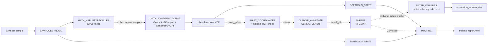

# Human-DNAseq-chr20-nf-dsl2: human chr20 germline variant calling pipeline

[](https://github.com/mujtababarsi/Human-DNAseq-chr20-nf-dsl2/actions/workflows/ci.yml)
[](https://opensource.org/licenses/MIT)

## Introduction

Human-DNAseq-chr20-nf-dsl2 is a germline short-variant calling pipeline written in
[Nextflow](https://www.nextflow.io) DSL2. It uses Samtools and GATK4 to call SNPs and indels
from mapped whole-genome sequencing (BAM) data. All tools are containerised. Optional
annotation steps add ClinVar clinical significance and SnpEff functional effects, and pull
out protein-altering and de novo variants in a trio (see [Annotation](#annotation)).

The pipeline has Docker, Singularity and Conda profiles. So far it has been run with Docker,
locally and on GitHub Actions.

## Structure

`main.nf` builds the input channel from a samplesheet and passes it to the `DNASEQ_WORKFLOW`
sub-workflow (`workflows/dnaseq.nf`). The sub-workflow connects ten single-purpose processes
defined under `modules/`. The four annotation processes (dotted arrows) are each skipped when
their parameter is unset. The VCF then goes straight on to the next step.



Nextflow also writes the execution DAG of each run to a file (see [Reports](#reports)).

## Steps

1. `Samtools index` creates a `.bai` index for each input BAM.
2. GATK `HaplotypeCaller` calls variants in each sample, in GVCF mode.
3. GATK `GenomicsDBImport` combines the per-sample GVCFs into a GenomicsDB data store, and
   `GenotypeGVCFs` produces one cohort-level VCF.
4. For QC, `samtools stats` and `flagstat` check each sample's alignments and `bcftools stats`
   checks the joint VCF. MultiQC collects these into one interactive report.
5. Optionally, the test-excerpt coordinates are shifted onto GRCh37 chr20, ClinVar
   `CLNSIG`/`CLNDN` are added (`bcftools annotate`), SnpEff predicts effects, and
   `bcftools view` filters protein-altering and de novo variants in the trio.

| Process                | Tool(s)                                  | Container                                                            |
|-------------------------|-------------------------------------------|------------------------------------------------------------------------|
| `SAMTOOLS_INDEX`        | Samtools `index`                          | `community.wave.seqera.io/library/samtools:1.20--b5dfbd93de237464`     |
| `GATK_HAPLOTYPECALLER`  | GATK `HaplotypeCaller` (`-ERC GVCF`)      | `community.wave.seqera.io/library/gatk4:4.5.0.0--730ee8817e436867`     |
| `GATK_JOINTGENOTYPING`  | GATK `GenomicsDBImport` + `GenotypeGVCFs` | `community.wave.seqera.io/library/gatk4:4.5.0.0--730ee8817e436867`     |
| `SAMTOOLS_STATS`        | Samtools `stats` + `flagstat`             | `community.wave.seqera.io/library/samtools:1.20--b5dfbd93de237464`     |
| `BCFTOOLS_STATS`        | Bcftools `stats`                          | `quay.io/biocontainers/bcftools:1.23.1--hb2cee57_0`                    |
| `MULTIQC`               | MultiQC                                   | `quay.io/biocontainers/multiqc:1.27--pyhdfd78af_0`                     |
| `SHIFT_COORDINATES`     | awk + Bcftools `view`/`norm --check-ref`  | `quay.io/biocontainers/bcftools:1.23.1--hb2cee57_0`                    |
| `CLINVAR_ANNOTATE`      | Bcftools `annotate`                       | `quay.io/biocontainers/bcftools:1.23.1--hb2cee57_0`                    |
| `SNPEFF`                | SnpEff 5.4                                | `quay.io/biocontainers/snpeff:5.4.0c--hdfd78af_0`                      |
| `FILTER_VARIANTS`       | Bcftools `view`/`query`                   | `quay.io/biocontainers/bcftools:1.23.1--hb2cee57_0`                    |

## Test data

The test data in `data/` is a family trio (mother, father, son). It is mapped Illumina
short-read WGS data, cut down to a small slice of chromosome 20 (hg19/b37) so the whole
pipeline runs quickly. It is the official dataset of the Nextflow
["Nextflow for Science: Genomics"](https://training.nextflow.io/latest/nf4_science/genomics/)
training course (see [Credits](#credits)).

For your own data, point `--input` at a samplesheet like `assets/samplesheet.csv`:

```csv
sample_id,reads_bam
SAMPLE1,/path/to/sample1.bam
SAMPLE2,/path/to/sample2.bam
```

## Annotation

Variant calling finds where the trio differs from the reference. Annotation adds information
about what those differences might mean. It checks whether a variant has been reported to
ClinVar, predicts its effect on genes with SnpEff, and filters for variants worth a closer
look. Each step is optional and runs only when its parameter is set.

### Method

| Step | What it does | Why |
|---|---|---|
| `SHIFT_COORDINATES` (`--contig_offset`) | Renames contig `20_10037292_10066351` to `20`, adds 10,037,292 to every `POS`, and rewrites the `##contig` line to GRCh37 chr20 (length 63,025,520) | The bundled test reference is a 29 kb excerpt whose position 1 is GRCh37 chr20:10,037,293. ClinVar and SnpEff use whole-chromosome coordinates, so without the shift no variant could match. Only needed for excerpt references; a run against a full reference leaves it off |
| REF check (`--ref_check_fasta`) | `bcftools norm --check-ref e` against the Ensembl GRCh37 release 75 chr20 FASTA; any mismatch fails the run | Checks the offset before anything is annotated. A wrong offset (even by one base) puts `REF` alleles against the wrong reference bases and is caught here; an nf-test checks exactly this |
| `CLINVAR_ANNOTATE` (`--clinvar`) | `bcftools annotate -c INFO/CLNSIG,INFO/CLNDN`, matched by position and allele | Adds the clinical significance (e.g. Pathogenic, Likely_benign) and disease name for variants already submitted to ClinVar |
| `SNPEFF` (`--snpeff_db`) | SnpEff 5.4 with database `GRCh37.75` writes `INFO/ANN` (gene, consequence, impact HIGH/MODERATE/LOW/MODIFIER), plus HTML and CSV summaries (the CSV is added to the MultiQC report) | Predicts the effect of every variant, including ones that are not in ClinVar |
| `FILTER_VARIANTS` (`--proband`, `--father`, `--mother`) | Protein-altering: `INFO/ANN` impact HIGH or MODERATE (only when SnpEff ran). De novo: proband heterozygous and both parents homozygous reference. Writes `annotation_summary.tsv` | Narrows the list to variants that change a protein, and to variants seen in the child but in neither parent, which are common candidates when a condition appears for the first time in a family. Samples are looked up by name, so VCF column order does not matter |

Each annotation module has a positive control in the nf-test suite (a real ClinVar record,
synthetic HIGH/MODERATE and de novo variants, and a deliberately wrong offset), so a zero
result can be told apart from a broken step. See
[`tests/fixtures/README.md`](tests/fixtures/README.md).

### Data sources

| Resource | Version | Used for | In this repo? |
|---|---|---|---|
| [ClinVar](https://www.ncbi.nlm.nih.gov/clinvar/) GRCh37 VCF (NCBI) | fileDate 2026-10-19 | `CLINVAR_ANNOTATE` | Only `data/annotation/clinvar_region.vcf.gz` (header plus the test region, which has 0 records) and one record as a test fixture |
| [SnpEff](https://pcingola.github.io/SnpEff/) database | SnpEff 5.4, `GRCh37.75` (Ensembl 75) | `SNPEFF` | No (~540 MB). Download once with `snpEff download -dataDir /abs/path GRCh37.75` |
| Ensembl GRCh37 chr20 FASTA | release 75 (`Homo_sapiens.GRCh37.75.dna.chromosome.20.fa`) | REF check | No (~63 MB). From the Ensembl GRCh37 FTP; index with `samtools faidx` |

### Results on the bundled trio

With the full chr20 FASTA and the SnpEff database available locally:

```bash
nextflow run main.nf -profile test,docker \
    --snpeff_db       /abs/path/snpeff_db \
    --ref_check_fasta /abs/path/Homo_sapiens.GRCh37.75.dna.chromosome.20.fa
```

| Check | Result |
|---|---|
| Variants in the joint VCF | 18 (12 SNPs, 6 indels, 0 multiallelic) |
| REF check after the shift (offset 10,037,292) | 18/18 match GRCh37.75 chr20 |
| ClinVar matches (`CLNSIG`/`CLNDN`) | 0/18. ClinVar has no records in 20:10,037,000-10,067,000 (the nearest records are at 20:10,036,845, just before the region, and 20:10,177,592 after it) |
| SnpEff impact | 18/18 MODIFIER (8 downstream of *ANKEF1*, 6 intronic and 4 downstream of *SNAP25-AS1*); no protein-coding changes |
| Protein-altering (HIGH/MODERATE) | 0 |
| De novo (son het, both parents hom-ref) | 0 |

These match the same steps done by hand on the same VCF. Two further checks were done by
hand and are not pipeline outputs. All 18 genotype sets are Mendelian-consistent. The son is
heterozygous at only one site (20:10,046,828), inherited from the father (1/1), so the de novo
filter had a heterozygous call to test and correctly rejected it.

`-profile test` (and therefore CI) runs the shift, ClinVar and filter steps. It does not run
SnpEff or the REF check, which need the large files above. The limits of the annotation are
listed under [Known limitations](#known-limitations).

## Input checks and retries

- The samplesheet and every reference file are checked with `checkIfExists: true`, and the
  workflow stops with a clear error if no samples are found.
- Processes are labelled `process_low` or `process_medium`. Their `cpus` and `memory` are set
  in `nextflow.config`, not in each process.
- Processes killed by an out-of-memory or termination signal (exit codes 137/139/143) are
  retried automatically before the run is allowed to fail.

## Running it

1. You need [Nextflow](https://www.nextflow.io/docs/latest/install.html) (>=25.10.0) and
   Docker. See [Reproducibility](#reproducibility) for the other profiles.

2. Clone the repository:

   ```bash
   git clone https://github.com/mujtababarsi/Human-DNAseq-chr20-nf-dsl2.git
   cd Human-DNAseq-chr20-nf-dsl2
   ```

3. Run on the bundled test data:

   ```bash
   nextflow run main.nf -profile test,docker
   ```

4. Run on your own samples:

   ```bash
   nextflow run main.nf \
       --input           samplesheet.csv \
       --reference       ref.fasta \
       --reference_index ref.fasta.fai \
       --reference_dict  ref.dict \
       --intervals       intervals.bed \
       --cohort_name     my_cohort \
       -profile docker \
       -resume
   ```

   Add any of the annotation parameters below, for example
   `--clinvar clinvar.vcf.gz --snpeff_db /abs/path/snpeff_db --proband CHILD --father DAD --mother MUM`.

### Parameters

| Parameter          | Description                                                          |
|---------------------|----------------------------------------------------------------------|
| `input`             | CSV samplesheet listing `sample_id,reads_bam`                        |
| `reference`         | Reference genome FASTA                                               |
| `reference_index`   | Reference `.fai` index                                               |
| `reference_dict`    | Reference sequence dictionary (`.dict`)                              |
| `intervals`         | BED file of genomic intervals to call variants over                  |
| `cohort_name`       | Name used for the final joint-called VCF                             |
| `outdir`            | Directory results are published to (default: `results`)              |
| `contig_offset`     | Annotation: add this to `POS` and rename `source_contig` to `target_contig` (test excerpt only) |
| `source_contig` / `target_contig` / `target_contig_length` | Contig to shift, its new name, and the new `##contig` length (all required with `contig_offset`) |
| `ref_check_fasta`   | Full-chromosome FASTA (with `.fai`) to check every shifted `REF`; fails on mismatch |
| `clinvar`           | Bgzipped ClinVar VCF with its `.tbi` next to it; adds `CLNSIG`, `CLNDN` |
| `snpeff_db`         | SnpEff data directory containing `<snpeff_genome>/`; SnpEff is skipped when unset |
| `snpeff_genome`     | SnpEff database name (default: `GRCh37.75`)                          |
| `proband` / `father` / `mother` | Trio sample names (as in the VCF header) for `FILTER_VARIANTS`; set all three or none |

Parameters are checked against [`nextflow_schema.json`](nextflow_schema.json) at the start of
every run, so missing or malformed inputs fail straight away. `--help` prints the full usage
message, generated from the same schema:

```bash
nextflow run main.nf --help
```

## Testing

The [nf-test](https://www.nf-test.com/) suite covers six of the ten processes (plus a
stub-only test for `SNPEFF`), the `DNASEQ_WORKFLOW` sub-workflow, and a full end-to-end run
with and without annotation:

```
tests/
├── main.nf.test                          # full pipeline: without annotation, and with it (as -profile test)
├── workflows/dnaseq.nf.test               # sub-workflow: joint VCF, annotation, fail-fast check
├── modules/
│   ├── samtools_index.nf.test
│   ├── samtools_stats.nf.test
│   ├── gatk_haplotypecaller.nf.test
│   ├── shift_coordinates.nf.test          # shift arithmetic, REF check pass + fail, missing contig
│   ├── clinvar_annotate.nf.test           # real ClinVar record (positive) + empty region (negative)
│   ├── snpeff.nf.test                     # stub only (database not available in CI)
│   └── filter_variants.nf.test            # synthetic trio: de novo, HIGH/MODERATE, lookup by name
└── fixtures/                              # small test-only VCFs, see fixtures/README.md
```

Install [nf-test](https://www.nf-test.com/installation/) and run the whole suite with:

```bash
nf-test test --profile docker
```

nf-test 0.9.0 (the version CI uses) writes test scripts that the stricter default parser in
Nextflow 26.04 rejects, so every module and workflow test fails to compile there. Run the
suite locally with Nextflow 25.10.x instead. It was checked with:

```bash
NXF_VER=25.10.3 nf-test test --profile docker
```

On every push and pull request, CI (`.github/workflows/ci.yml`) runs the `-profile test,docker`
smoke test on the minimum supported Nextflow version (25.10.0) and on the latest release. It
also runs the full `nf-test` suite on 25.10.0.

## Reproducibility

The pipeline has three execution profiles. In each one, every tool runs in a version-pinned
container or environment.

- `-profile docker` (the default) uses Biocontainers and Seqera Wave images, pinned by tag.
- `-profile singularity` uses the same containers, for HPC clusters without Docker. It has
  not been tested yet.
- `-profile conda` uses the environment definitions in `envs/*.yml`, for systems with no
  container runtime. It has not been tested yet.

Combine any of the three with `-profile test` to run on the bundled test data.

## Reports

Every run writes two kinds of report.

The QC report collects `samtools stats`/`flagstat` for each sample and `bcftools stats` for the
joint VCF (and SnpEff's summary, when SnpEff runs) into one MultiQC dashboard:

```
results/qc/multiqc/multiqc_report.html
```

The execution reports describe how the run itself went. They are written to
`results/pipeline_info/` on every run:

- `trace.txt`: per-task resource usage and exit status
- `timeline.html`: visual execution timeline
- `execution_report.html`: full run report
- `pipeline_dag.html`: the resolved execution DAG for that exact run

The execution reports are switched on in `nextflow.config` (the `dag`, `timeline`, `report`
and `trace` blocks). Run the pipeline as normal and open the HTML files afterwards:

```bash
nextflow run main.nf -profile test,docker
open results/qc/multiqc/multiqc_report.html        # QC dashboard
open results/pipeline_info/pipeline_dag.html        # execution DAG
```

On Linux, use `xdg-open` instead of `open`.

## Outputs

```
results/
├── indexed_bam/                          # each input BAM + its .bai index
├── gvcf/                                 # per-sample GVCFs (*.g.vcf) + indices
├── <cohort_name>.joint.vcf               # final cohort-level joint-genotyped VCF
├── <cohort_name>.joint.vcf.idx
├── annotation/                           # only when annotation params are set
│   ├── <cohort_name>.shifted.vcf.gz(.tbi)        # GRCh37 coordinates (--contig_offset)
│   ├── <cohort_name>.ref_check.txt               # "REF check passed: N/N" (--ref_check_fasta)
│   ├── <cohort_name>.clinvar.vcf.gz(.tbi)        # + CLNSIG, CLNDN (--clinvar)
│   ├── <cohort_name>.snpeff.vcf                  # + INFO/ANN (--snpeff_db)
│   ├── <cohort_name>.snpeff.{html,csv,genes.txt} # SnpEff summaries
│   ├── <cohort_name>.protein_altering.vcf.gz     # HIGH/MODERATE (only when SnpEff ran)
│   ├── <cohort_name>.de_novo.vcf.gz              # proband het, both parents hom-ref
│   └── <cohort_name>.annotation_summary.tsv      # total / ClinVar / protein-altering / de novo counts
├── qc/
│   ├── samtools/                         # per-sample *.stats.txt + *.flagstat.txt
│   ├── bcftools/                         # <cohort_name>.bcftools_stats.txt
│   └── multiqc/
│       ├── multiqc_report.html           # aggregated QC dashboard
│       └── multiqc_data/
└── pipeline_info/                        # trace, timeline, report, DAG
```

## Known limitations

- It has only been tested on a chr20 trio (mother, father, son). It hasn't been run on a
  whole genome yet.
- It starts from aligned BAM files, so it doesn't do alignment, duplicate marking or base
  quality score recalibration (BQSR).
- The variant-calling and QC steps have been run end to end with Docker, locally and on
  GitHub Actions, where the nf-test suite passes. The annotation steps and their tests have
  so far been run locally only (Docker; Nextflow 25.10.3 and 26.04.6).
- The Singularity and Conda profiles haven't been tested, including the new SnpEff conda
  environment (`envs/snpeff.yml`). It hasn't been run on an HPC cluster.
- The annotation steps have these limits:
  - The coordinate shift is only needed for the bundled test excerpt. Data aligned to a full
    GRCh37 reference needs no shift, so leave `--contig_offset` unset.
  - The test region has 0 ClinVar records, so the pipeline test can only show 0 matches. The
    positive control for ClinVar annotation is the one-record nf-test fixture.
  - SnpEff is skipped in CI because its database is too large, and its nf-test is a stub. A
    real SnpEff run has only been checked locally.
  - There are no population allele frequencies (e.g. gnomAD) or in-silico pathogenicity
    scores, so common variants are not filtered out.
  - **This is not a clinical variant classification.** Nothing here applies the ACMG/AMP
    criteria. ClinVar labels are copied as they appear in ClinVar.
  - The de novo filter uses genotypes only (no depth, quality or allele-balance thresholds),
    so real data would need extra filtering against false positives.
  - The trio is the public Nextflow training dataset, a small slice of chr20, so no
    pathogenic findings are expected. The results say nothing about these individuals'
    health.
- It doesn't yet meet every [nf-core](https://nf-co.re/) guideline:
  - There are no per-process `versions.yml` files recording exact tool versions. For now,
    the container tags in `modules/*.nf` are the record.
  - Containers are pinned by tag, not by SHA256 digest.
  - It hasn't had a full `nf-core pipelines lint` pass.

## Credits

Pipeline commands and dataset adapted from the Nextflow
["Nextflow for Science: Genomics"](https://training.nextflow.io/latest/nf4_science/genomics/)
training course (© Seqera, [CC BY-NC-SA 4.0](https://creativecommons.org/licenses/by-nc-sa/4.0/)).
Project layout conventions (`workflows/`, `envs/`, `assets/`, resource labels, multi-profile
execution) follow the structure of
[mujtababarsi/Human-RNAseq-nf-dsl2](https://github.com/mujtababarsi/Human-RNAseq-nf-dsl2).

Annotation resources:

- ClinVar, from the National Center for Biotechnology Information (NCBI). GRCh37 VCF from
  <https://ftp.ncbi.nlm.nih.gov/pub/clinvar/>. Landrum MJ *et al.* ClinVar: improving access
  to variant interpretations and supporting evidence. *Nucleic Acids Res.* 2018;46(D1):D1062-D1067.
- SnpEff. Cingolani P *et al.* A program for annotating and predicting the effects of
  single nucleotide polymorphisms, SnpEff. *Fly (Austin)*. 2012;6(2):80-92.
- Ensembl GRCh37 release 75 provides the chromosome 20 FASTA (REF check) and the
  `GRCh37.75` gene models behind the SnpEff database.
- Bcftools. Danecek P *et al.* Twelve years of SAMtools and BCFtools. *GigaScience*.
  2021;10(2):giab008.

## License

Pipeline code in this repository is released under the MIT License (see `LICENSE`).
